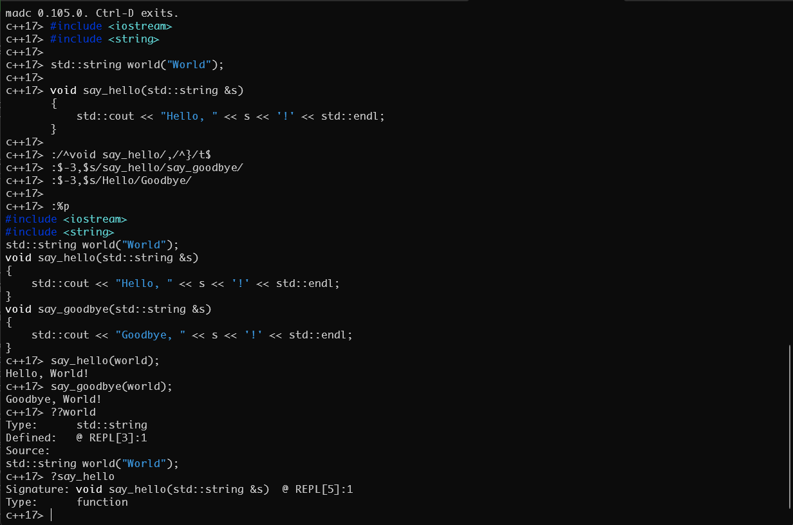

# madc

**A self-contained C and C++ compiler — JIT, AOT and an interactive REPL in
one small download.**

madc compiles standard C (C89 through C23) and C++ (C++98 through C++20) with
its own front end and its own code generator. It runs a program straight from
source, in memory; writes native objects and executables; emits portable C11;
and opens an interactive REPL. It needs no GCC, Clang or LLVM, no linker, and
no headers on disk: the C, POSIX and C++ standard-library headers ship inside
madc.

madc is not a new language wearing C's syntax. It compiles the C and C++ you
already have — and, as one more `--std=`, offers its own dialect for code that
wants less ceremony.

[Install](#install) · [Usage](docs/usage.md) · [Benchmarks](docs/benchmarks/README.md) ·
[Conformance](docs/conformance-coverage.md) · [Changelog](CHANGELOG.md) ·
[Security](SECURITY.md)

<p align="center"></p>

*The REPL: C++ typed in; a function copied and renamed with ex commands
(`:t`, `:s`); both versions called; then `??world` and `?say_hello` ask the
session what it knows.*

## One compiler, every way to run code

Ordinary C++, nothing madc-specific:

```cpp
#include <iostream>
#include <string>

int main()
{
    std::string who = "world";
    std::cout << "Hello, " << who << "!\n";
}
```

```bash
madc hello.cpp               # compile in memory and run it (JIT)
madc -o hello hello.cpp      # a native executable (AOT)
madc -c hello.cpp            # an object file — g++ and clang++ link it
madc --emit=c11 hello.cpp    # the same program as portable C11 source
madc                         # the REPL
```

- **JIT.** `madc file.cpp` compiles into memory and runs — usually before
  g++ or clang++ would have finished linking (see [Speed](#speed)). A
  `#!/usr/bin/env madc` line makes a source file an executable script.
- **AOT.** `-o` writes the executable itself; there is no linker to call. A
  C++ hello-world is a 22 KB executable that needs only the C and C++
  runtime libraries, not madc. `-c` objects use the Itanium C++ ABI and
  real mangled names, so they link with g++- and clang++-built code.
- **C11 out.** `--emit=c11` renders any program, C++ included, as strict
  C11 that any C compiler accepts.
- **REPL.** `madc` with no file is an interactive C and C++ session:
  declarations and statements as you type them, named results, `?name` and
  `??name` to look things up, `%whos`, history and completion, syntax
  colour, and an ex-style editor (`:p`, `:s`, `:t`, `:w`) over the
  session's own buffer — an edited function is redefined at once.
- **Projects.** `--project compile_commands.json` compiles, links and runs a
  multi-file program, or writes one executable. The flagship case is SMAUG
  1.8: about 158,000 lines of C89 in 51 translation units, run both ways.

## Self-contained

| madc does not need | because |
|---|---|
| GCC, Clang or LLVM | its own front end lowers to an IR that its own copy of [MIR](#built-on-mir) compiles for x86-64 and ARM64 |
| a linker | it writes ELF, PE and Mach-O objects and executables itself |
| system headers | the C library, POSIX and C++ standard-library headers are built into madc |

What it does use is the platform's own runtime: the C library and one C++
standard library — libstdc++ on Linux and Windows, libc++ on macOS, where it
is part of the OS. On Linux it also uses the system's zlib, zstd and PCRE2;
the Windows zip carries the DLLs it needs.

| Platform | Packages | Download |
|---|---|---:|
| Linux x86-64 | `.deb` (Ubuntu 22.04, 24.04), `.rpm`, tarball | 18–19 MB |
| Windows x86-64 | zip | 18 MB |
| macOS (Apple silicon, Intel) | tarball | 16 MB |

## Built on MIR

One large third-party component makes this possible:
[MIR](https://github.com/vnmakarov/mir), Vladimir Makarov's lightweight JIT
compiler infrastructure, and c2mir, its C11 compiler (MIT licence).

The division is clean. madc's front end reads C, C++ and the dialect,
resolves classes, templates and overloads, and builds c2mir's own C11 syntax
tree directly — c2mir never sees source text. c2mir checks that tree and
lowers it to MIR; MIR's generator turns it into machine code, in memory for
the JIT or as a native object.

madc carries its own maintained copy of MIR in
[`third_party/mir`](third_party/mir) — a git subtree with upstream history
kept, built and released with madc. To upstream MIR it adds:

- native **object and executable writers** — ELF, PE/COFF and Mach-O;
- C language features: native `_Complex`, `__attribute__((cleanup))`,
  vector types up to 16 bytes, and `volatile` accesses that every
  optimization pass respects;
- ABI and code-generation fixes for variadic calls, `_Complex`, `_Alignas`
  and ARM64.

Fixes that belong to MIR itself are offered upstream as pull requests.

## Speed

madc 0.105.0 against g++ 13.3 and clang++ 18.1 on the same machine
(Ubuntu 24.04, x86-64), in milliseconds, best of 7 runs, interleaved —
lower is better:

| task | madc | g++ / gcc | clang++ / clang |
|---|---:|---:|---:|
| `hello.cpp` (`<iostream>`), source to output | **83** | 170 | 207 |
| `<vector>` + `<map>` + `<string>` program, source to output | **209** | 252 | 275 |
| `hello.c` (`<stdio.h>`), source to output | **9** | 21 | 37 |
| compile `hello.cpp` to an object | **93** | 144 | 171 |
| compile `string-build.cpp` to an object | **56** | 93 | 111 |
| compile `vector-sum.cpp` to an object | **51** | 82 | 92 |
| compile SMAUG `act_wiz.c` (12,041 lines of C89) | 241 | 402 | **161** |

*Source to output* is madc's JIT against compiling and linking at `-O0`,
then running. For objects, g++/gcc and clang++/clang run at `-O0` and madc
at its default, `-O1`. madc's edge is C++ headers: they are parsed once,
when madc is built, not on every compile. On large C files clang is faster.

Generated code runs at about 81% of the speed of `gcc -O2` on MIR's C
benchmark set (geometric mean; madc wins some). Method, every row and the
history: [docs/benchmarks](docs/benchmarks/README.md).

## Compatibility

Measured on test suites madc does not own — gcc's own testsuite and the
third-party c-testsuite:

| corpus | standard | passing |
|---|---|---:|
| gcc `c-torture/execute` | C17 | **99.2%** (1611 of 1624) |
| [c-testsuite](https://github.com/c-testsuite/c-testsuite) `single-exec` | C11 | **100%** (220 of 220) |
| `g++.dg/template` | C++98 | 81.3% |
| `g++.dg/cpp0x` + `template` | C++11 | 77.3% |
| `g++.dg/cpp1y` | C++14 | 51.3% |
| `g++.dg/cpp1z` | C++17 | 43.2% |
| `g++.dg/cpp2a` | C++20 | 53.8% |

madc's own suite of over 2,000 programs passes on Linux, Windows and macOS
(Apple silicon and Intel), with libstdc++ and with libc++. Scope and caveats:
[docs/conformance-coverage.md](docs/conformance-coverage.md).

## The madc dialect — C and C++ without the ceremony

The name stands for *My Advanced Dialect of C*. The dialect is `--std=madc`,
the default for `.mad` files, listed beside `c17`, `c++20` and the rest; a
`.c` or `.cpp` file keeps its own standard's rules.

```c
#!/usr/bin/env madc
// No #include, no using, no main().
var names = { "ada lovelace", "grace hopper", "dennis ritchie" };
for ( var n : names )
    println("{:<16} {}", python::title(n), php::strtoupper(n));
```

```text
Ada Lovelace     ADA LOVELACE
Grace Hopper     GRACE HOPPER
Dennis Ritchie   DENNIS RITCHIE
```

- **Auto-include.** The standard library is in scope with no `#include`.
- **Auto-namespace.** Names resolve without `using` or `std::`.
- **Auto-main.** Top-level statements run as the program; madc writes
  `main()` when there is none.
- **`var`.** One value type for strings, numbers, arrays and objects;
  `print`, `println` and `format` for output.
- **Portable.** The same script runs on Linux, Windows and macOS. A library
  is named as a module, never as a file — madc spells `.so`, `.dylib` or
  `.dll` for the platform — and madc's own modules (git, Markdown, a native
  window) load the moment a script uses them:

  ```c
  #!/usr/bin/env madc
  long repo = git::open(".");
  var hist;
  git::log(hist, repo, "", 3);
  for ( var c : hist["rows"] )
      println("{}  {}", perl::substr(c["sha"], 0, 9), c["summary"]);
  ```

## Batteries included

- **Functions from other languages**, each in its own namespace:

  | Namespace | Focus |
  |---|---|
  | [`php::`](docs/language/ns-php.md) | strings and arrays: split, join, sort |
  | [`perl::`](docs/language/ns-perl.md) | regex grep, glob, split, chop, chomp |
  | [`python::`](docs/language/ns-python.md) | formatting, alignment, title case, zero fill |
  | [`ruby::`](docs/language/ns-ruby.md) | tr, squeeze, chars, rotate |
  | [`js::`](docs/language/ns-js.md) | Base64, URL encoding, JSON |
  | [`rust::`](docs/language/ns-rust.md) | strings, collections, `rust::match` |

- **Native libraries without bindings.** `-lfoo` loads a library for a JIT
  run or links it into an executable; include its header and call it.
  `import name as ns;`, `dlopen` and `dlsym` cover loading at run time.
- **Language extras.** Multiple return values, `defer`, `:=`, regular
  expressions (PCRE2), and [namespace precedence](docs/language/prefer.md).
- **A Language Server.** `madc --lsp` gives any LSP editor diagnostics,
  hover, go to definition, references, document symbols and semantic
  colour.
- **A Model Context Protocol server.** `madc --mcp` gives an AI agent the
  program's structure as a graph, with a project memory.
- **Embedding.** `libmadc` ([`madc_api.h`](include/madc_api.h)) compiles
  and runs files or strings inside another program, calls its functions,
  registers host callbacks, and limits what the code may reach.

## Install

Packages for each release are on the
[releases page](https://github.com/derekbsnider/madc/releases): install the
`.deb` or `.rpm`, or unpack the tarball or zip anywhere and run `bin/madc`.

From source — MIR is in the tree, so one clone is enough:

```bash
git clone https://github.com/derekbsnider/madc.git
cd madc
autoreconf -fi
./configure
make -C src release      # bin/madc-release: optimized, headers built in
```

See [docs/build.md](docs/build.md) for dependencies, build modes and
packaging.

## Releases

The current release is **0.105.0**. What changed, release by release:
[CHANGELOG.md](CHANGELOG.md) and [docs/release-notes/](docs/release-notes/).

## Documentation

- [Usage and the command line](docs/usage.md)
- [Compiler architecture](docs/architecture.md) — source → `cir_node`
  (MC11-IR) → c2mir → MIR → JIT or native output
- [Build and installation](docs/build.md)
- [Benchmarks](docs/benchmarks/README.md) ·
  [Conformance](docs/conformance-coverage.md) ·
  [Test status](docs/test-status.md)
- [Modern language features](docs/language/modern/) ·
  [Regular expressions](docs/language/regex.md) ·
  [Multiple return values](docs/language/multiple-returns.md)

## Contributing

Start with [`AGENTS.md`](AGENTS.md), the project briefing for contributors
and coding agents. The rules live in [`.claude/rules/`](.claude/rules/), with
their reasoning in [`docs/rules/`](docs/rules/).

## Security

See [SECURITY.md](SECURITY.md) to report a vulnerability privately.

## License

madc is licensed under the [Mozilla Public License 2.0](LICENSE).

## Built on madc

- **[madcide](https://github.com/derekbsnider/madcide)** — an IDE, in a
  terminal or a window, whose editor, REPL and problem list run on madc's own
  engine.
- **[Chthonia](https://github.com/derekbsnider/chthonia)** — an easy IDE
  for learning C and C++, built on madcide.
